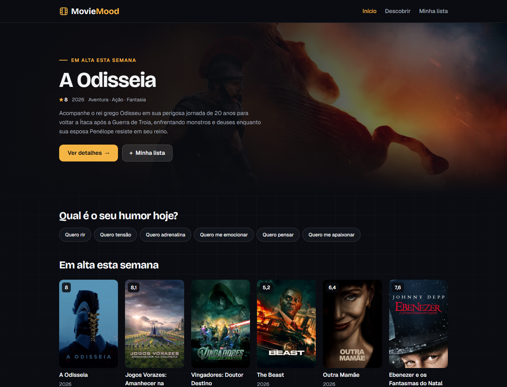

<h1 align="center">MovieMood</h1>

<p align="center">
  Find a movie that matches your mood.<br />
  A movie discovery app built with React 19, TypeScript and TanStack Query, powered by the TMDB API.
</p>

<p align="center">
  <a href="https://github.com/PontesEdu/MovieMood/actions/workflows/ci.yml"></a>
  
  
  
  
  
</p>

<p align="center">
  
</p>

## Table of contents

- [About](#about)
- [Features](#features)
- [Tech stack](#tech-stack)
- [Getting started](#getting-started)
- [Available scripts](#available-scripts)
- [Project structure](#project-structure)
- [Technical highlights](#technical-highlights)
- [Development workflow](#development-workflow)
- [Roadmap](#roadmap)
- [Acknowledgements](#acknowledgements)

## About

MovieMood is a single-page application for discovering movies. You can browse what is trending this week, pick a mood such as "I want to laugh", search by title, filter by genre, year and sort order, and keep a personal watchlist.

The project was built to practice modern React (19) and the tooling used in professional frontend teams: typed API layer, server-state caching, URL-driven state, accessibility, linting, formatting and continuous integration. The interface is in Brazilian Portuguese.

## Features

- **Trending hero**: a full-width banner with the top trending movie of the week.
- **Mood chips**: one click takes you to movies of the matching genre.
- **Search**: search movies by title. The search term lives in the URL, so results can be shared and survive a reload.
- **Filters**: browse by genre, release year and sort order (most popular, top rated, newest).
- **Movie details**: backdrop, poster, rating, runtime, genres, tagline and overview.
- **Watchlist**: save movies to "Minha lista". It is stored in `localStorage` and the header shows how many movies are saved.
- **Loading and error states**: skeleton loaders, empty states and a dedicated "movie not found" message.
- **Accessibility**: semantic HTML, keyboard focus styles, `aria-current` and `aria-pressed` states, and screen reader text.
- **Responsive layout** from mobile to large screens.

## Tech stack

| Area         | Technology                                                                               |
| ------------ | ---------------------------------------------------------------------------------------- |
| UI           | [React 19](https://react.dev)                                                            |
| Language     | [TypeScript](https://www.typescriptlang.org)                                             |
| Build tool   | [Vite](https://vite.dev)                                                                 |
| Routing      | [React Router 8](https://reactrouter.com) (data mode)                                    |
| Server state | [TanStack Query 5](https://tanstack.com/query)                                           |
| Styling      | [Tailwind CSS 4](https://tailwindcss.com)                                                |
| Data         | [TMDB API](https://developer.themoviedb.org) with native `fetch`                         |
| Code quality | ESLint, Prettier (with `prettier-plugin-tailwindcss`)                                    |
| CI           | GitHub Actions (format check, lint, type check and build on every push and pull request) |

## Getting started

### Prerequisites

- [Node.js](https://nodejs.org) 24 (see [`.nvmrc`](.nvmrc))
- A free [TMDB](https://www.themoviedb.org/signup) account to get an API read access token

### Installation

```bash
git clone https://github.com/PontesEdu/MovieMood.git
cd MovieMood
npm install
```

### Environment variables

Copy the example file and add your token:

```bash
cp .env.example .env
```

```env
VITE_TMDB_TOKEN=your_tmdb_api_read_access_token
```

You can create the token in [TMDB settings > API](https://www.themoviedb.org/settings/api) (use the **API Read Access Token**).

> [!NOTE]
> This is a client-only app, so the token is included in the JavaScript bundle and visible in the browser. Use a read-only token. A production version should send the requests through a backend or serverless function that keeps the token on the server.

### Run

```bash
npm run dev
```

Open [http://localhost:5173](http://localhost:5173).

## Available scripts

| Script                 | Description                              |
| ---------------------- | ---------------------------------------- |
| `npm run dev`          | Starts the development server            |
| `npm run build`        | Type checks and builds for production    |
| `npm run preview`      | Serves the production build locally      |
| `npm run lint`         | Runs ESLint                              |
| `npm run format`       | Formats the code with Prettier           |
| `npm run format:check` | Checks formatting without changing files |

## Project structure

```
src/
├── api/          # TMDB client and request functions (no React)
├── components/   # Reusable UI components
├── context/      # Watchlist context and provider
├── hooks/        # Custom hooks (TanStack Query and context)
├── pages/        # Route components
├── types/        # Shared TypeScript types
├── utils/        # Pure formatting helpers
├── main.tsx      # Router, QueryClient and providers
├── root-layout.tsx
└── container-layout.tsx
```

Data flows in one direction: **component → hook → api → client**. Components never call `fetch` directly.

## Technical highlights

- **URL as state.** Search terms and filters are stored in the query string with `useSearchParams` and a React Router `<Form>`, instead of `useState` synced with `useEffect`. The back button, reloads and shared links all work.
- **Server state with TanStack Query.** Every request has a query key that includes its inputs, so results are cached per search or filter combination. Genres use `staleTime: Infinity` because they rarely change, and 404 responses are not retried.
- **Two discovery modes.** TMDB's search endpoint ignores genre filters, so the discover page uses `/search/movie` when there is a search term and `/discover/movie` with filters otherwise. Sorting by rating requires a minimum vote count, and sorting by date excludes movies not yet released.
- **Watchlist with React 19 context.** Uses `<Context value>` and `use(Context)`, persisted to `localStorage` through an effect. Only the fields needed by the movie card are stored.
- **Layout routes.** A pathless layout route adds the page container, so the home page can render a full-width hero.
- **Typed API layer.** A generic `tmdbFetch<T>` builds URLs with `URL` and `searchParams` and throws a typed `TmdbError` with the HTTP status.

## Development workflow

- **GitHub Flow**: every change is made on a branch and merged through a pull request with squash merge.
- **[Conventional Commits](https://www.conventionalcommits.org)**: `feat:`, `fix:`, `refactor:`, `docs:`.
- **Continuous integration**: a GitHub Actions workflow checks formatting, lint, types and build on each pull request.
- **Learning log**: notes about decisions and mistakes are kept in [`docs/aprendizados.md`](docs/aprendizados.md) (in Portuguese).

## Roadmap

- [x] Trending movies, details page and search
- [x] Genre, year and sort filters
- [x] Mood chips
- [x] Watchlist with local persistence
- [x] Home hero and active navigation links
- [ ] Unit and component tests with Vitest and Testing Library
- [ ] Pagination or infinite scroll
- [ ] Backend proxy to keep the TMDB token private

## Acknowledgements

Movie data and images are provided by [TMDB](https://www.themoviedb.org).


This product uses the TMDB API but is not endorsed or certified by TMDB.

---

Made by [PontesEdu](https://github.com/PontesEdu).
